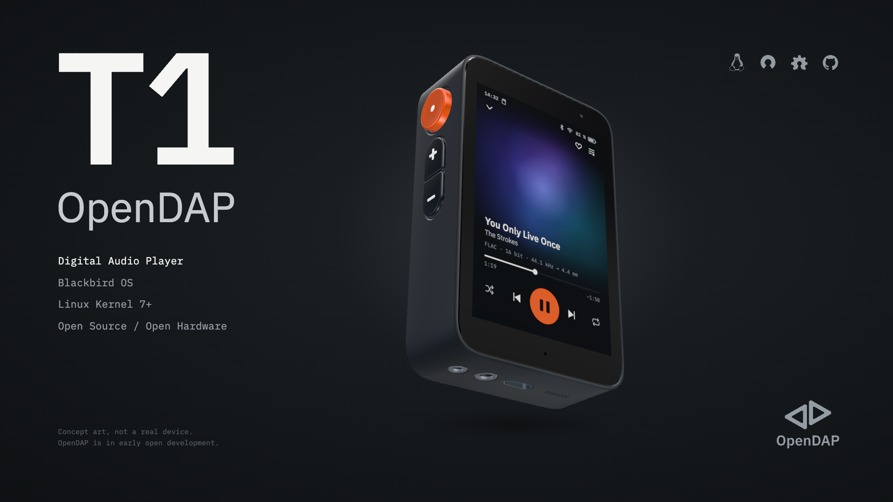

# OpenDAP workspace



OpenDAP is an Open Source, Open Hardware Digital Audio Player (DAP) that runs entirely on Linux. This is the root of its working tree: the contributor guide ([`CONTRIBUTING.md`](CONTRIBUTING.md), the rules for every repository, which Claude Code loads through `CLAUDE.md`), the list of public repositories and the bootstrap script.

## Set up

```sh
git clone https://github.com/opendap-project/workspace.git opendap
cd opendap
scripts/bootstrap.sh            # clone every repository you can access
public/toolkit/host/setup.sh    # install the developer host tools
scripts/bootstrap.sh            # run again to install pre-commit in every clone
```

- Public repositories are listed in `repos.tsv` and always cloned.
- Private repositories are listed in the private overlay (`opendap-project/workspace-private`); each one is cloned only if you have access to it. Use `--public-only` to skip them, `--update` to fast-forward existing clones, `--json` for a machine-readable report.

## Templates

[`templates/`](templates/) holds the boilerplate every repository shares (agent settings and rules, lint configuration); `odapkit sync --check` reports copies that drifted and `odapkit sync --apply` repairs them.

## Accepted RFCs

The workspace root has no `docs/`, so it records here the outcome of each accepted [RFC](https://github.com/opendap-project/rfcs) that changes it.

- [RFC 0003](https://github.com/opendap-project/rfcs/blob/main/text/0003-blackbird-os.md): the operating system is Blackbird OS; its repository `blackbird-os` is cloned at `public/blackbird-os`.
- [RFC 0005](https://github.com/opendap-project/rfcs/blob/main/text/0005-blackbird-ui.md): the design system repository is `blackbird-ui`, cloned at `public/blackbird-ui`.
- [RFC 0007](https://github.com/opendap-project/rfcs/blob/main/text/0007-virtual-devices.md): the virtual devices have their own repository, `virtual-devices`, cloned at `public/virtual-devices`.
- [RFC 0008](https://github.com/opendap-project/rfcs/blob/main/text/0008-repository-restructure.md): repositories are grouped by audience and domain: generic ones at the top of `public/`, the T1's under `public/devices/t1/`, the maintainers' tools under `public/toolkit/`; a tool finds another repository through `repos.tsv` or `ODAP_<REPOSITORY>_DIR`.
- [RFC 0016](https://github.com/opendap-project/rfcs/blob/main/text/0016-outdoor-hat.md): `repos.tsv` lists `hat-outdoor`, cloned at `public/hats/outdoor`.
- [RFC 0017](https://github.com/opendap-project/rfcs/blob/main/text/0017-naming-and-topology.md): the workspace keeps its name and is the `workspace` root; a repository is renamed or moved only at its root's cut, and keeps today's name and path until then.

## License

This repository follows the [REUSE](https://reuse.software) layout: license texts live in `LICENSES/` and `REUSE.toml` maps each path to its license.

- Default (docs): **Creative Commons Attribution-ShareAlike 4.0** (`CC-BY-SA-4.0`)
- `scripts/`: **GNU GPL v3.0 or later** (`GPL-3.0-or-later`)
- `templates/`: **MIT** (`MIT`)

Copyright © 2026 The OpenDAP Project.
